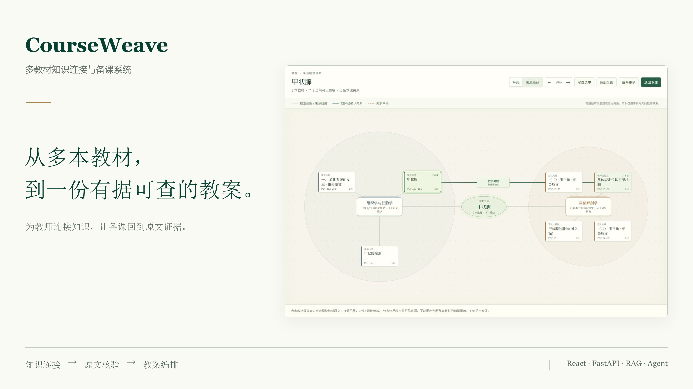
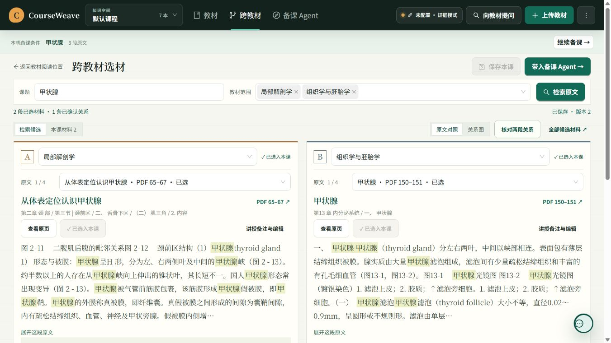
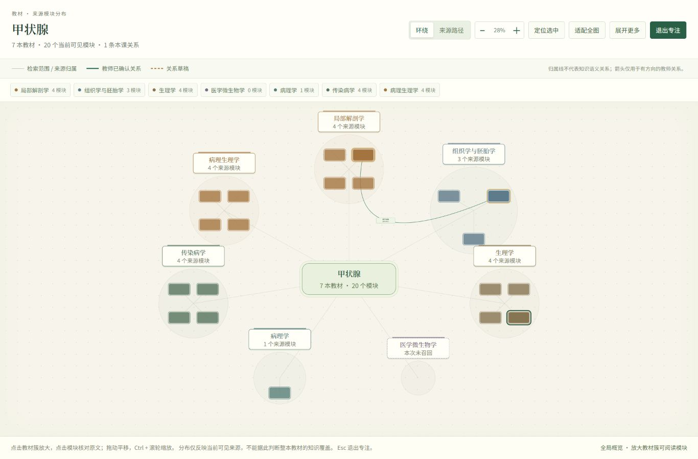
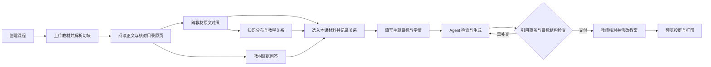
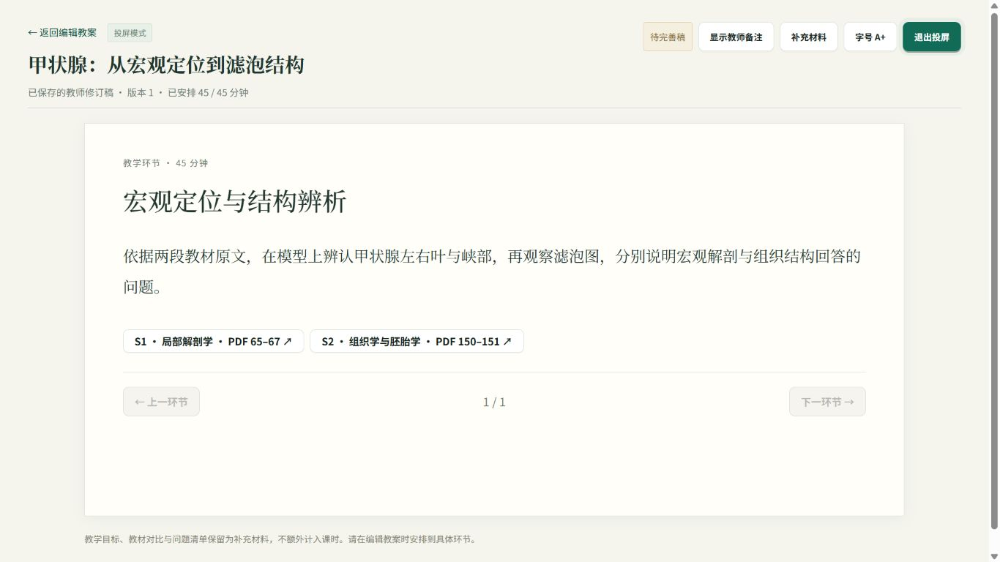

# CourseWeave · 多教材知识连接与备课系统

[](https://github.com/zphsswl/courseweave/actions/workflows/ci.yml)



[查看 3840 × 2160 高清原图](./docs/showcase/courseweave-project-showcase-hd.png) · [可编辑 SVG](./docs/showcase/courseweave-project-showcase-hd.svg)

> 上传多本教材，将章节、知识点、跨教材关系和问答结果组织成一套可回到原文核验的课程知识空间。

CourseWeave 面向需要同时使用多本教材的教师。教师可以阅读完整正文、对照 PDF 原页，按主题比较不同教材的表述，选入本课材料并记录关系，再交给备课 Agent 整理成可修改、可回查来源的教案。跨教材默认展示原文对照，关系图用于辅助探索与核对。

教师既可以直接向教材提问，也可以输入备课主题，让备课 Agent 根据检索结果逐轮选择动作、补充证据、修订教案，并在必要时询问教师。原有 RAG 保持独立，通过工具接口供 Agent 调用。

<details>
<summary>查看真实界面：原文对照与知识分布</summary>



并排核对两本教材的原文，再选入材料和记录关系。检索命中仍需教师判断是否适用于当前课题。



知识分布按课题、教材、来源模块形成嵌套圆环。点击教材可放大模块，再点节点回查原文；可切换来源路径、专注查看和展开更多。使用说明与验证记录见[知识分布](./docs/knowledge-distribution.md)。

</details>

## 核心能力

- **任意课程，而非写死学科**：以课程工作区组织教材，支持 PDF、Markdown 和 TXT。
- **页码感知解析**：保留物理页、章节范围、chunk 偏移与来源原文；低文本页会提示 OCR 风险。
- **目录核对与来源保护**：解析时已按章节切块，教师可对照原页修改标题与层级，确认后再进行知识抽取。未被下游材料引用的 PDF 可修正页码范围并同步重建正文与分块；已有引用时锁定范围，保护旧证据。
- **来源节点与统一概念分离**：每本教材中的表述保留为独立 occurrence；跨教材“同一概念”通过 canonical concept 连接，不覆盖原文。
- **证据质量门禁**：概念和语义关系必须绑定可在 chunk 中逐字找到的原文；证据不足的结果不会伪装成高质量节点。
- **跨教材原文对照**：按主题检索并排阅读不同教材，选入原文、记录备注和讲授顺序；关系记录保留双侧证据与教师理由。关系图作为辅助视图，关键词命中不会自动连成知识关系。
- **知识分布图**：以“课题 → 教材 → 来源模块”的嵌套圆环查看分布，也可切换来源路径；点击教材聚焦、点击模块核对原文，支持专注查看、缩放平移和增量展开。分别显示已载入原文数与模块数，未命中教材仍保留；教师关系与来源归属线分开呈现。
- **混合检索可降级**：BM25、真实向量检索和图谱扩展分别记录。向量模型不可用时明确降级为 BM25 + 图谱，不用哈希向量冒充语义能力。
- **对比式 RAG**：可选择多本教材，按共同结论、各教材表述、差异/冲突和教学提示组织回答，并返回教材、章节、页码、chunk 与原文引用。
- **模型驱动备课 Agent**：模型逐轮选择查询 RAG、读取原文、起草、检查、修订、询问教师或交付；每次动作及结果持久化，检索与生成有独立预算，遇到缺项可改变策略。
- **教师检查点与交付门禁**：章节未确认或需要教师补充时暂停，回答后续跑；服务端检查教材范围、页码、引用、课时和交付结构。支持停止并保留现有成果，教师保存稿受保护。
- **可编辑教案与打印版**：保存教师修订稿，预览教学环节、进入投屏，或导出 Markdown、打开 HTML 打印版并通过浏览器保存为 PDF。
- **查证与恢复**：悬浮问答在此浏览器保留最近 5 次查证，可打开引用原页并收集到本机备课条件；批量引用合并时保留已填学情、目标、课时与原有对照板。教材处理状态和已保存教案可在刷新后继续查看。

## 核心工作流



## 备课 Agent

实现细节与实际输出见[系统实现详解与真实案例报告](./docs/Agent系统实现详解与真实案例报告.md)（[21 页 PDF](./output/pdf/courseweave-agent-implementation-report-20261029.pdf)）。报告逐项说明工具协议、SQLite 状态、上下文裁剪、任务记忆、人工教案模板，并保留一次真实运行的成功步骤与异常退出。

顶部进入“备课 Agent”，输入主题与目标，选择 1–12 本教材，可补充教学对象、先修知识、课时与课堂问题数量后启动。也可从教材小节、跨教材材料或查证引用带入上下文。工作台以教案文档为中心，处理过程按需展开：

1. `Prepare`：检查教材与章节确认状态，必要时先解析；这些是确定性前置条件。
2. `Decide → Act → Observe`：模型每轮只提出一个动作，服务端校验参数、执行工具并保存结果；模型根据真实反馈选择下一步，界面展示实际轨迹和预算。
3. `Ask & Resume`：章节未确认或模型提出必要问题时保存检查点，教师确认或回答后继续；可主动停止，保留已有证据与稿件。
4. `Validate & Revise`：服务端核验来源、覆盖、课时、问题数量和结构，将缺项反馈给模型；模型可补查或改稿，再次检查。
5. `Deliver`：只有当前稿通过服务端检查才能交付为待教师审核的草稿。预算耗尽或多轮无进展会保留部分成果与停止原因，不能冒充成功。

v3 是一个有预算和工具白名单的单 Agent。原有检索、融合、回答和引用方法不变；默认内部调用现有 RAG，也可配置 `AGENT_RAG_URL` 通过 HTTP 接入同数据源的 RAG 服务。历史 v2 任务仍按旧流程恢复；未配置模型时明确显示“原文证据工作流”，已有模型任务不会因撤除配置而重跑并覆盖稿件。详见[Agent 系统架构与复现](./docs/Agent系统架构.md)。

想掌握实现细节，可按[Agent 架构技术复盘](./docs/Agent架构技术复盘.md)中的学习路线阅读。该文档由独立子 agent 根据代码和测试维护，逐项解释设计原因、替代方案、取舍和关键失败路径；项目约定要求后续架构改动同步累积记录。



上图为人工验收教案的投屏状态：45 分钟单环节、S1 / S2 引用，用于验证保存、恢复和展示。它不是完整课程质量样本，也不代表在线模型生成内容已通过教学审核。

Agent 用于完成备课交付，悬浮问答用于快速查证；问答引用按批次加入本机备课条件，消费后清除队列，刷新不会重复添加。已有表单保留目标、学情、课时和自己的对照板上下文；查看历史教案时收集新引用，会先保留旧条件与未保存编辑，再形成下一次备课条件，不自动修改已保存教案。只有教材小节上下文时显示“已选小节”，不会误报为 0 段原文。这些条件保存在当前浏览器；对照板、Agent 任务与修订稿仍分别保存，尚未统一为服务端 Lesson 对象。

自动检查核对引用编号、来源范围、教材覆盖和交付结构，不证明结论在语义上得到引用支持。模型不可用时提供证据材料与未完成说明；实际生成内容的准确性和课堂适用性仍需教师核对。

## 为什么不直接合并同名节点

不同教材可能使用相同术语但定义范围不同，也可能用不同术语表达同一概念。直接去重会丢失来源、差异和版本信息。因此数据模型分为四层：

| 层 | 作用 |
|---|---|
| `Course` | 一门课程及其教材集合 |
| `KnowledgeNode` | 某本教材中的知识点出现，保留定义、章节、页码和原文 |
| `CanonicalConcept` | 课程级统一概念，只负责连接多个来源出现 |
| `KnowledgeEdge` + `RelationEvidence` | 教材内/跨教材关系及双侧证据 |

底层图谱与 API 保留这四层数据及来源表述。当前教师主界面的材料对照板单独保存选材与人工关系，不会因为同名或改了显示标题就自动合并概念。

## 界面信息架构

- `教材`：上传、处理状态、目录核对、正文阅读与个人收藏。
- `跨教材`：原文对照、知识分布、教学关系三种视图；选材、记录关系和整理材料路径后带入备课。
- `备课 Agent`：新建或复用备课条件，查看教案历史，核对并修改文档，按需展开处理过程。
- `教案预览`：按已安排的教学环节浏览；投屏时先隐藏教师提示，未绑定到环节的比较和问题保留为补充材料。
- `向教材提问`：可拖动、缩放的悬浮查证窗，保留最近 5 次查证，支持查看原页及收集引用。

## 技术架构

| 范围 | 实现 |
|---|---|
| 前端 | React 18、TypeScript、Vite、Ant Design、Cytoscape.js |
| API | FastAPI、Pydantic |
| 数据 | SQLAlchemy + SQLite；课程/教材/页/章节/chunk/节点/边/证据/审核事件 |
| 解析 | PyMuPDF / pypdf；页码感知章节映射 |
| 检索 | rank-bm25；可选 sentence-transformers + ChromaDB；知识图谱扩展；RRF 融合 |
| 生成 | OpenAI-compatible API；提示注入边界；无模型时返回原文证据而非编造回答 |
| Agent | 模型逐轮决策、工具契约、独立 RAG 适配、持久检查点、预算、教师问答与服务端验证 |
| 任务 | SQLite 持久任务记录 + 单 worker 队列；支持重启恢复、续跑和失败重试 |
| 部署 | 多阶段 Docker；FastAPI 同源托管前端；可选持久磁盘 |

## 快速开始

环境要求：Python 3.11+、Node.js 20+。

### 已配置项目：Windows 一键启动

如果依赖和前端已经构建完成，直接双击根目录的 `start-courseweave.cmd`，或运行：

```powershell
.\.venv\Scripts\python.exe .\scripts\start_local.py
```

启动成功后访问 <http://127.0.0.1:8001/>。脚本会自动复用已运行的服务，并把运行日志写入 `.runtime` 目录。

复制到另一台 Windows 电脑的 `.venv` 可能仍引用原电脑的 Python。启动器会检查解释器及依赖，只在 Python 主次版本匹配且依赖可导入时复用现有包；未找到可用环境会给出重建提示，不会自动安装依赖。可通过 `COURSEWEAVE_PYTHON` 指定已配置的解释器。

### 首次安装

```bash
git clone <your-repository-url>
cd courseweave

python -m venv .venv
# Windows
.venv\Scripts\activate
# macOS / Linux
# source .venv/bin/activate

pip install -r requirements.txt
copy .env.example .env  # Windows；macOS/Linux 使用 cp

cd frontend
npm ci
npm run build
cd ..

uvicorn backend.main:app --reload --port 8001
```

浏览器访问 `http://localhost:8001`。开发前端可另开终端运行：

```bash
cd frontend
npm run dev
```

默认代理后端地址为 `http://localhost:8001`。

## 配置

```dotenv
LLM_PROVIDER=openai
LLM_API_KEY=
LLM_BASE_URL=https://api.openai.com/v1
LLM_MODEL=gpt-4o-mini
LLM_TRUST_ENV_PROXY=false
EMBEDDING_MODEL=paraphrase-multilingual-MiniLM-L12-v2
DATABASE_URL=sqlite:///./data/medessence.db
CHROMA_PERSIST_DIR=./data/chroma
CORS_ORIGINS=http://localhost:5173,http://127.0.0.1:5173
MAX_UPLOAD_SIZE_MB=50
PUBLIC_DEMO_READ_ONLY=false
SEED_DEMO_DATA=false
```

`LLM_API_KEY` 为空时，系统仍可解析、切块、执行质量规则和 BM25 检索；生成式回答会降级为原文证据展示。没有安装 sentence-transformers 时，索引会明确显示 `BM25 + graph`，不会报告向量检索成功。`LLM_TRUST_ENV_PROXY` 默认关闭，避免桌面环境中与模型无关的失效系统代理导致误报；确实需要通过系统代理访问模型时再设为 `true`。

## 关键 API

| 方法 | 路径 | 用途 |
|---|---|---|
| `POST` | `/api/courses` | 创建课程工作区 |
| `POST` | `/api/textbooks/upload` | 向课程上传教材 |
| `PATCH` | `/api/textbooks/{id}/chapters` | 修改并确认完整章节列表；符合条件时同步修正页码范围 |
| `GET` | `/api/jobs?course_id=...` | 恢复每本教材最近一次解析或知识整理状态 |
| `POST` | `/api/jobs/extract-graph` | 抽取教材知识图谱 |
| `POST` | `/api/jobs/integrate` | 生成跨教材关联候选 |
| `GET/PATCH` | `/api/courses/{course_id}/alignments` | 查看与审核跨教材关系 |
| `GET` | `/api/courses/{course_id}/concepts/{id}` | 查看统一概念及各教材出现 |
| `POST` | `/api/rag/index` | 构建课程检索索引 |
| `POST` | `/api/rag/query` | 课程问答或跨教材对比 |
| `POST` | `/api/agent/runs` | 创建目标驱动的备课 Agent 任务 |
| `GET` | `/api/agent/runs?course_id=...` | 查看持久化任务历史与执行轨迹 |
| `POST` | `/api/agent/runs/{id}/resume` | 人类检查点确认后续跑 |
| `POST` | `/api/agent/runs/{id}/respond` | 回答当前问题后从检查点继续，携带 request_id |
| `POST` | `/api/agent/runs/{id}/cancel` | 停止 v3 活跃任务并保留证据与稿件 |
| `POST` | `/api/agent/runs/{id}/retry` | 重试失败任务 |
| `PATCH` | `/api/agent/runs/{id}/draft` | 保存教师修订稿并检查版本与引用 |
| `GET` | `/api/agent/runs/{id}/export?format=html` | 获取已保存教案的 HTML 打印版；也支持 Markdown |

启动后可在 `/docs` 查看完整 OpenAPI 文档。

## 测试与验证

```bash
.venv\Scripts\python.exe -m compileall -q backend tests
.venv\Scripts\python.exe -m unittest discover -s tests -v

cd frontend
npm run build
node --test tests/*.test.mjs
```

前端纯模型测试直接导入 TypeScript；本轮使用 Node.js 24.15.0 运行。Node.js 20 可构建应用，运行这些测试还需支持原生 TypeScript 类型擦除的 Node.js 环境。

自动化测试覆盖课程隔离、来源 occurrence 保留、页码与分块映射、引用与交付结构、无证据关系拒绝、Agent 检查点续跑，以及目录校对的范围锁定与事务回滚、问答选材合并、教案打印、任务恢复和课程报告范围。离线测试通过不代表在线模型生成内容已完成语义质量验证。

2026-10-21 上传验证：后端 223 项离线 unittest、前端 64 项模型回归通过；TypeScript 与 Vite 生产构建通过，前端回归已纳入 GitHub CI。主包约 985 kB，仍有包体积警告。本次修正教案导出的非 PDF 来源位置标签，补充历史教案收集材料及跨空间状态恢复回归，并加入 3840 × 2160 项目展示图。

2026-10-28 Agent v3 本地验证：后端 **310 项**、前端 **83 项**通过，TypeScript 与 Vite 构建通过。独立子 agent 对恢复、来源、取消与队列交接进行了故障注入并复测；隔离合成材料浏览器验收通过。原 RAG 核心文件保持不变，在线模型教学语义质量未在本轮验证。详见[工程验收记录](./docs/evaluation/agent-v3-engineering-validation-20261028.md)。

2026-10-20 视觉验收：1366 × 768 桌面完成原文对照、问答保留、选材、关系确认、教案保存恢复和投屏验证；知识分布使用 7 本教材从 20 个模块展开至 57 个，支持教材聚焦和原文核对。390 × 844 移动端未发现横向溢出。

打印按钮的 HTML 请求返回 200；IAB 未跟踪到新窗口，另通过导出 URL 视觉确认打印版中的中文状态、学情与引用。尚未验收原生打印对话框或 PDF 文件落盘。自然问题查证返回 8 段引用，其中仍有非当前切面的候选；本轮不据此声称整体准确率已量化提升。

固定评测集包含 420 道教师问题：100 道人工核心题、274 道章节覆盖题（137 章、每章 2 题）、26 道跨教材题和 20 道域外拒答题。合计 380 道可回答题（其中 41 道跨教材题）和 40 道拒答题。以下为对应评测报告中 7 本教材、137 章、6,498 个 chunk 的历史语料快照结果，本轮界面优化未重跑该评测，也不以这些指标证明生成结论正确：

| 指标 | 结果 |
|---|---:|
| 检索召回率@8 | 380/380，100% |
| 引用准确率@3 | 985/1,134，86.86% |
| 跨教材覆盖率@8 | 41/41，100% |
| 无答案拒答率 | 40/40，100% |
| 章节题命中率@8 | 274/274，100% |
| 章节覆盖率@8 | 137/137，100% |

运行 `scripts/build_chapter_benchmark.py` 可从当前章节与知识节点重建不含教材原文的题集；运行 `scripts/run_teacher_benchmark.py` 可重新生成带题集哈希、语料哈希、逐题结果、题型分层和适用边界的报告。详见 [RAG 教师问题评测报告](./docs/evaluation/teacher-benchmark-v3.md)。

完整的优化前后对比、严格评测口径、技术路线和 Agent 定位见 [RAG 优化与项目技术路线](./docs/RAG优化与项目技术路线.md)。

评估重点不是只看“回答像不像”，而是分别统计：

1. 章节边界准确率与页码命中率
2. 节点证据覆盖率与关系证据有效率
3. 跨教材候选 Recall@K、审核通过率和冲突率
4. 检索 Recall@K、引用准确率和无答案拒答率
5. 教师完成一次审核所需时间

## 部署

Docker 本地运行：

```bash
docker build -t courseweave .
docker run --rm -p 7860:7860 \
  -e PUBLIC_DEMO_READ_ONLY=true \
  -v courseweave-data:/home/user/app/data \
  courseweave
```

仓库提供 `render.yaml`。其中 `SEED_DEMO_DATA=true` 会幂等创建一门由原创短文本构成的示例课程；`PUBLIC_DEMO_READ_ONLY=true` 只允许浏览样例和进行证据问答，上传、抽取、审核和删除在公开环境中被禁止。公开部署默认不配置模型密钥，问答以教材证据降级模式运行；完整模型与写入流程应在本地或具备鉴权、限流和费用配额的私有部署中运行。

## 一次完整的使用流程

1. 创建课程并上传教材，解析完成后阅读正文、核对目录与原页。
2. 从当前小节备课，或选择多本教材并排查阅同一主题的原文，选入材料、记录讲授备注与关系。
3. 需要临时查证时打开悬浮问答；可查看原页，将引用收集到本机备课条件。
4. 在备课工作台填写主题、目标与学情，确认教材范围、课时和问题数量，再手动启动 Agent。
5. 核对草稿的引用、教材覆盖与未完成项目，修改后保存；处理完成不等于教学目标已经完成。
6. 预览教学环节、按需投屏，或打开打印版通过浏览器打印/保存 PDF。下次可复用条件新建，原教案继续保留。

## 已知边界

- 本机备课条件、个人收藏与查证记录依赖当前浏览器存储；尚未提供跨设备同步或统一的服务端 Lesson 对象。
- 目录校对不支持新增、删除、拆分章节。已有知识点或备课引用时锁定页码范围，只允许修改标题与层级；历史引用不会自动迁移到新范围。
- 引用与覆盖检查不保证语义正确；课堂问题目前是问题清单，参考答案、提问目的和评价标准需要教师补充。
- 投屏沿用已保存教案内容；整课教师提示尚未逐环节绑定。PDF 通过 HTML 打印版和浏览器打印生成，尚无 DOCX 或原生 PDF 导出接口。
- 扫描版 PDF 目前只提示 OCR 风险，尚未内置 OCR 队列。
- SQLite 适合单机部署与演示；多用户生产环境应迁移到 PostgreSQL，并将后台任务迁移到持久队列。
- 公开只读模式不是完整鉴权系统；正式 SaaS 需要用户、组织、课程权限、配额与审计。
- 教材版权属于原作者；公开仓库和在线演示不应包含未授权教材全文。

## 仓库说明

`.env`、数据库、向量索引、教材文件、构建产物和本地虚拟环境已被 `.gitignore` 排除。提交前仍应运行密钥扫描，并确认 Git 历史中不存在已泄露 token。

本项目代码采用 [MIT License](./LICENSE)。教材及其原文内容仍归各自权利人所有，不包含在本项目的软件许可范围内。

## 延伸文档

- [五模块架构简图：LLM、工具、状态、上下文与记忆](./docs/showcase/courseweave-agent-five-blocks.png)
- [Agent 系统实现详解与真实案例报告](./docs/Agent系统实现详解与真实案例报告.md)
- [详细报告 PDF](./output/pdf/courseweave-agent-implementation-report-20261029.pdf)
- [用户操作与技术链路：一堂 45 分钟课如何贯穿前端、Agent、RAG 与数据库](./docs/Agent用户操作与技术链路.md)
- [Agent / RAG 两页架构图、选型与验证说明](./output/pdf/courseweave-agent-rag-architecture-20261029.pdf)
- [Agent 系统架构与复现](./docs/Agent系统架构.md)
- [Agent 架构技术复盘：原因、替代方案与关键逻辑](./docs/Agent架构技术复盘.md)
- [Agent v3 工程验收记录](./docs/evaluation/agent-v3-engineering-validation-20261028.md)
- [RAG 优化与项目技术路线](./docs/RAG优化与项目技术路线.md)
- [420 题 RAG 教师问题评测报告](./docs/evaluation/teacher-benchmark-v3.md)
- [版本记录](./CHANGELOG.md)
