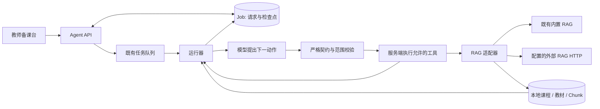

# CourseWeave 备课 Agent 系统架构

本轮新增 `lesson_agent_v3`：模型根据当前材料和上一次工具结果，每次提出一个动作；服务端校验、执行并保存检查点，再决定是否允许继续。它可以补检索、读原文、修订草稿、检查交付或等待教师回答，执行顺序不再由固定八步决定。

这是一套有范围、有预算的单 Agent 运行器。RAG 继续提供教材查证能力；教材来源、教师修订稿和任务终止权由服务端管理。

## 1. 代码入口与数据流

| 模块 | 职责 |
| --- | --- |
| [`lesson_policy.py`](../backend/agents/lesson_policy.py) | 将受限状态交给模型，每次获取一个公开动作及其参数 |
| [`lesson_contracts.py`](../backend/agents/lesson_contracts.py) | 严格 JSON 契约、动作白名单、参数与教材范围校验、重复动作指纹 |
| [`lesson_runtime.py`](../backend/agents/lesson_runtime.py) | 工具执行、预算、检查点、等待教师、取消保护与结束判断 |
| [`rag_tool.py`](../backend/agents/rag_tool.py) | 内置 / HTTP RAG 适配、响应边界、本地原文重新装载 |
| [`course_agent.py`](../backend/agents/course_agent.py) | 版本分流、既有证据工作流、教案生成与来源/交付检查 |
| [`agent.py`](../backend/api/agent.py) | 创建、读取、回答、停止、章节确认、教师修订与导出 API |
| [`AgentWorkbench.tsx`](../frontend/src/components/AgentWorkbench.tsx) | 执行模式、实际动作记录、预算、教师输入和可恢复的教案编辑 |



模型接收到的是有长度限制的请求、材料摘录、草稿、检查结果、最近六条动作和预算。教材与工具文本被标记为不可信数据；它们不能创建新的工具权限。公开 `summary` 只描述将执行的动作，前端不展示思维链或原始模型响应。

## 2. 七个工具及执行边界

| 动作 | 模型可提交的主要参数 | 服务端行为 |
| --- | --- | --- |
| `inspect_course` | 无 | 读取当前范围内教材状态和已有证据数量 |
| `query_rag` | `question`、范围内 `textbook_ids`、`mode`、`top_k` | 调用 RAG，将通过本地校验的原文加入材料池 |
| `read_source` | `chunk_id` | 按真实 Chunk ID 读取当前课程、当前教材内的原文 |
| `write_draft` | `instructions` | 基于真实证据、教师回答及已有检查反馈起草或修订；不覆盖教师保存稿 |
| `validate_draft` | 无 | 检查来源、教材覆盖、课时及要求的交付结构，返回明确缺项 |
| `ask_teacher` | `question`、可选 `options` | 保存问题和唯一 `request_id`，进入 `waiting_user` |
| `finish` | 公开交付摘要 | 由服务端再次检查当前材料与草稿，满足交付条件才结束 |

契约拒绝额外参数、未知动作和类型强制转换。模型不能添加其他课程、任意 URL、文件或代码执行权限，也不能通过提交 `passed=true` 或 `semantic_reviewed=true` 把检查结果改为通过。任务最多选择 12 本教材，运行时最多保留 48 段原文；`query_rag` 的 Agent 参数要求 `top_k` 为 3–15。

“交付检查通过”表示来源和结构检查符合当前规则，仍需教师审核内容与教学适用性。

## 3. RAG 是独立工具，来源以本地记录为准

本轮保留既有 RAG 问答界面、检索方法与公开查询 API。`query_rag_tool()` 只是 Agent 调用它的边界：

- 未设置 `AGENT_RAG_URL`：调用既有 `rag_agent.query_rag()`。
- 设置 `AGENT_RAG_URL`：向该**完整查询地址**发送 HTTP POST，不自行追加路径。

HTTP 请求形状与已有查询输入一致：

```json
{
  "question": "本次需要查证的具体问题",
  "course_id": "当前课程ID",
  "textbook_ids": ["本次范围内教材ID"],
  "mode": "all",
  "top_k": 8
}
```

外部响应至少需要 `citations` 数组，每条提供可映射到本地的 `chunk_id`；可同时提供 `answer`、`answer_method` 和 `retrieval_trace`。远端独立的文档编号不能直接作为本系统来源，必须先建立与本地教材、Chunk 的对应关系。

适配器在调用前后核对课程和教材范围，并从本地数据库重取正文、书名、目录与页码。响应中的伪造摘录或页码不能替换这些记录；外来、错误、空白和重复来源被拒绝或去重。删减来源会使上游引用编号可能失效，因此出现相关警告时，回答降级为证据材料，不能继续照搬远端结论与 `[S#]` 编号。

HTTP 路径最多读取 1 MiB 响应，socket 各阶段超时配置不超过 30 秒，不跟随重定向，也不使用环境代理；这不是整个请求在 30 秒内强制结束的保证。调用地址和超时来自服务端配置，不能由模型参数指定。传输异常使用固定警告码返回，不能作为“没有相关知识”的证明。

## 4. 检查点、教师参与与停止

`Job.payload` 保存初始条件；`Job.result` 保存 `trajectory`、`budget`、`evidence`、`artifact`、`lesson_draft`、`delivery`、`teacher_answers` 等状态。动作执行前后会保存检查点。重新读取状态不会执行工具；失败重试恢复已保存状态，上一次未结束的动作被标记为中断，不直接把所有完成动作从头重放。

每段原文保留正文哈希和目录、页码等来源快照。再次使用或检查时会核对本地来源是否变化；发现变化应新建任务，保留教师已保存的稿件。

| API | 用途与约束 |
| --- | --- |
| `POST /api/agent/runs` | 根据真实课程和教材创建任务 |
| `GET /api/agent/runs/{id}` | 读取任务和已保存记录，不触发重跑 |
| `POST /api/agent/runs/{id}/respond` | `{ "answer": "…", "request_id": "…" }`；只接受当前教学问题，回答最多 2000 字 |
| `POST /api/agent/runs/{id}/resume` | 继续已完成章节确认的等待状态，不能绕过教学问题 |
| `POST /api/agent/runs/{id}/cancel` | v3 在排队、执行或等待时可停止；重复停止已取消任务不会重复执行 |
| `POST /api/agent/runs/{id}/retry` | 按既有重试条件恢复失败任务 |
| `PATCH /api/agent/runs/{id}/draft` | 使用 `expected_revision` 保存教师修订，冲突时拒绝覆盖 |

教师回答最多四次。回答、停止与章节续跑都通过当前状态和完整结果快照进行比较并更新；读取后若已有新检查点或新问题，会返回 409，保留新状态。旧问题或重复提交不能重复入队；前端把问题编号与回答输入绑定，并沿用课程、任务、请求 epoch 的校验，迟到响应不能覆盖另一份任务。

取消会先原子更新任务为 `cancelled`，后续检查点拒绝迟到写回，已保存材料与教师稿保留。它是协作式停止：已发出的网络调用可能等待返回或超时，不能把它理解为立即撤销外部请求或费用。

## 5. 预算与结束状态

默认预算在 `lesson_runtime.runtime_fields()` 中定义，可由服务端环境变量调整：

| 配置 | 默认值 | 允许范围 |
| --- | ---: | ---: |
| `AGENT_MAX_STEPS` | 12 轮 | 4–40 |
| `AGENT_MAX_RAG_QUERIES` | 6 次 | 1–15 |
| `AGENT_MAX_DRAFTS` | 3 次 | 1–6 |
| `AGENT_MAX_RUNTIME_SECONDS` | 300 秒 | 30–900 |

轮次在请求决策前计入，检索和起草在调用前计入；失败尝试不会自动退还预算。运行器还检查重复动作与无进展情况。耗尽预算、执行异常、模型决策不可用和教师取消分别保留 `stop_reason`，并尽量保留当前材料及明确缺项。

`completed` 只表示这次执行已结束。是否形成可用草稿由 `delivery.status` 区分：`draft_ready`、`needs_work` 或 `evidence_only`。前端展示实际用量，预算使用比例不作为课程完成百分比。运行时限用于调度和调用超时控制，不是操作系统级的强制终止保证。

## 6. 历史任务与无模型降级

- `lesson_agent_v2` 历史任务沿用原流程、保存稿和引用，不自动迁移成 v3 自主执行记录。
- 新任务未配置模型 Key 时，明确标记 `execution_mode="evidence_workflow"`，执行既有证据整理工作流；界面展示固定工作流记录，不冒称模型完成自主规划。
- 已配置模型但决策调用超时、不可用或返回无效动作时，保留实际失败 / 拒绝记录和检查点，不伪造下一动作。
- 前端为教师问题提供回答区，为章节校对保留独立入口；未知等待类型只提示核对，不自动继续。已有教案编辑、浏览器草稿恢复和版本冲突保护继续保留。

## 7. 工程复现与验证边界

使用已安装依赖的 Python 3.11 / 3.12 与 Node.js 24。以下示例在仓库根目录运行，显式关闭真实模型配置，后端回归使用测试自建的临时 / 内存数据库：

```powershell
$env:PYTHON_DOTENV_DISABLED = "1"
$env:LLM_API_KEY = ""
$env:OPENAI_API_KEY = ""
$env:AGENT_RAG_URL = ""
$env:HF_HUB_OFFLINE = "1"
$env:DATABASE_URL = "sqlite:///:memory:"

.\.venv\Scripts\python.exe -m unittest discover -s tests -v
Push-Location frontend
node --test tests/*.test.mjs
npm run build
Pop-Location
```

主要回归入口：[`test_lesson_policy.py`](../tests/test_lesson_policy.py)、[`test_agent_rag_tool.py`](../tests/test_agent_rag_tool.py)、[`test_agent_runtime.py`](../tests/test_agent_runtime.py)、[`test_agent_generation.py`](../tests/test_agent_generation.py)、[`test_agent_control_api.py`](../tests/test_agent_control_api.py)、[`test_agent_control_races.py`](../tests/test_agent_control_races.py)、[`test_agent_no_key_recovery.py`](../tests/test_agent_no_key_recovery.py)，以及前端 [`lesson-execution.test.mjs`](../frontend/tests/lesson-execution.test.mjs)、[`lesson-actions.test.mjs`](../frontend/tests/lesson-actions.test.mjs) 和既有备课条件恢复测试。

运行器测试使用脚本策略替代真实模型选择，并替代 RAG 传输和草稿模型；范围、来源、预算、检查点与交付检查执行真实生产逻辑。策略层使用模拟模型响应，HTTP RAG 测试使用模拟传输。前端回归核对显示模型、接口身份、重复点击、冲突和迟到响应等行为。

这些测试能验证控制流和工程约束，不能证明在线模型会稳定选择正确工具、检索证据充分、生成内容语义正确或教师效率提升。模型实际效果仍需独立的在线运行记录、人工教学评审和明确评测集；系统不会以模型自评或引用存在来代替这些证据。
