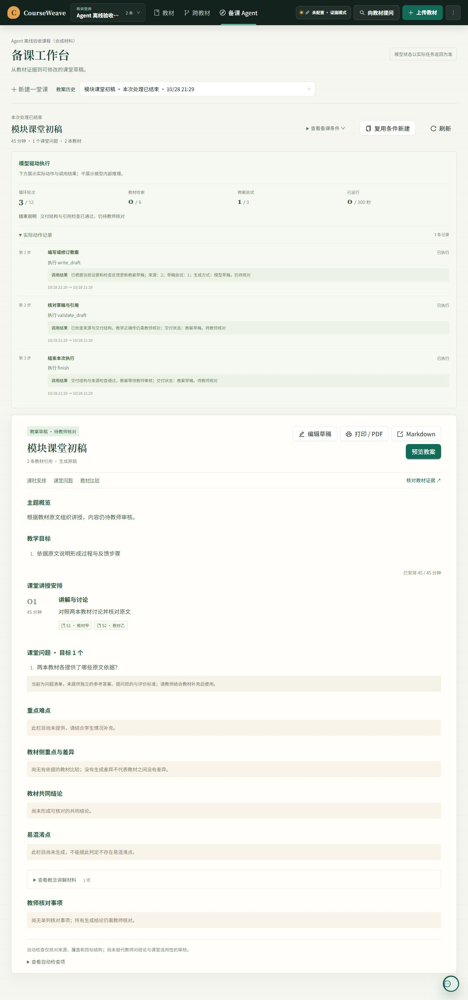

# Agent v3 工程验收记录

日期：2026-10-28。范围：本地工作区，尚未提交的新 Agent 改造。证据来自生产控制器、隔离数据库、独立子 agent 故障注入和真实浏览器；未调用在线模型进行教学质量评审。

## 验收结果

| 检查 | 结果 | 能说明什么 |
| --- | --- | --- |
| 后端全量 unittest | 310 项通过 | 既有功能与新增控制、状态、来源边界的回归 |
| 前端 Node 测试 | 83 项通过 | 备课条件、展示模型、回答/停止、冲突与迟到响应等 |
| TypeScript + Vite 生产构建 | 通过 | 类型检查与可构建性；仍有既有主包较大的提示 |
| 原 RAG 核心三文件 diff | 无差异 | 本轮未改变原检索、融合、回答及公开查询方法 |
| 隔离浏览器 | 已实测 | 建议填入不自动提交、刷新保留输入、真实 HTTP 停止、成果/预算/轨迹展示与时间一致性 |

测试基线为本轮改造前后端 223 项、前端 64 项；新增后端 87 项、前端 19 项。不以测试数量证明在线模型质量。

新增后端分组：RAG 适配 16、决策与契约 17、运行器 23、生成器 10、控制 API 9、并发控制 3、无模型恢复 5、队列交接 4。

## 独立复核实际发现并修复的故障

| 故障 | 修复与客观回归 |
| --- | --- |
| 中断恢复后计划行残留 running | 按 action ID 同步标记中断；`test_tool_interruption_resumes_without_replaying_completed_query_or_leaving_running_rows` |
| 移除模型配置后重试清空教师稿 | 已有模型轨迹/稿件停止并保留，禁止进入旧流程重生；`test_agent_no_key_recovery.py` 五项 |
| 读取空白 Chunk 后被算作某书的支持证据 | canonical hydration 拒绝空白正文；`test_empty_stored_source_cannot_count_as_a_books_supporting_evidence` |
| 直接读原文时，跨书章节引用绕过 RAG 层检查 | 运行器也联查真实章节并核对所属书；章节标题采用真实 Chapter 而非 Chunk 缓存；运行器两项章节一致性回归 |
| 停止读到旧快照，覆盖工具刚保存的新稿 | 停止更新增加完整结果快照比较；冲突返回 409 并保留新稿；`test_agent_control_races.py` |
| 旧 Q1 回答覆盖已进入 Q2 的任务（ABA） | 回答除状态和问题 ID 外比较完整结果快照；同上 |
| 章节续跑覆盖并发取消 | 状态与结果快照一起比较；同上 |
| 教师快速回答/重试/续跑时入队被旧 worker 去重吞掉 | worker 释放旧占用后核对最新 pending 状态并重新入队；`test_agent_queue_handoff.py` |
| 决策调用耗尽时限后仍启动工具 | 工具启动前再次检查剩余调度时间；`test_policy_spending_the_remaining_time_cannot_start_its_proposed_tool` |
| 等待章节确认前耗时未计入 | 统一计时检查点，教师离线等待不计入活动耗时；`test_chapter_pause_saves_active_elapsed_time_and_resume_excludes_teacher_wait` |
| 历史 UTC 无后缀时间与新轨迹相差 8 小时 | 前端统一解析历史 UTC 与显式时区；`lesson-execution.test.mjs` 时间回归及浏览器确认 |

队列问题做了红绿对比：仅在测试内存恢复原 worker 收尾实现时，回复、重试、章节确认三项交接均失败；使用当前实现时四项通过，续跑恰好保留一个队列项，终态不循环重排。

## 真实闭环测试的判断依据

`test_empty_query_changes_then_validation_failure_drives_a_real_revision` 执行生产运行器，脚本只替代决策模型与外部模型/检索传输：

1. 第一次查询无材料，下一轮状态确实收到新增证据数为 0。
2. 改写查询得到本地两本教材真实 Chunk，服务端重新装载原文。
3. 第一稿实际安排 40 分钟，针对任务要求 45 分钟的真实检查失败。
4. 第二次起草确实收到失败检查和上一版稿，修订为 45 分钟。
5. `finish` 再执行真实验证，输出 `draft_ready`，同时保留旧稿版本与 `semantic_reviewed=false`。

这证明反馈与修订上下文接线成立，不证明真实模型总能自主选择上述动作。

## 复现

在已安装依赖的环境中，从仓库根目录运行：

```powershell
$env:PYTHON_DOTENV_DISABLED = "1"
$env:LLM_API_KEY = ""
$env:OPENAI_API_KEY = ""
$env:DATABASE_URL = "sqlite:///:memory:"
python -m unittest discover -s tests -v
Push-Location frontend
node --test tests/*.test.mjs
npm run build
Pop-Location
git diff --exit-code -- backend/agents/rag_agent.py backend/services/retrieval_service.py backend/api/rag.py
```

本机使用 bundled Python 与项目已装依赖完成验收；项目复制来的 `.venv` 解释器不可直接运行，需使用有效解释器或重建虚拟环境。FastAPI TestClient 在受限执行环境中挂起，本轮在允许本地 sockets 的环境执行离线全量测试；未使用真实业务数据库。

## 界面证据与限制

下图使用两本合成教材和脚本决策构造任务，以验证界面；顶部模型状态为未配置。它不是在线模型样本，也不是课堂质量案例。



[停止操作后的真实界面](../screenshots/agent-v3-cancel-validation-20261028.png)。合成材料验收服务与临时浏览器标签页在验收后关闭。

尚未验证：真实模型的工具选择稳定性、教案语义正确率、真实教师备课时间收益、生产并发吞吐。引用存在和结构通过不能替代这些评测。当前为单 worker、JSON 检查点、协作式取消，已发出的外部调用不能被强杀，也不承诺 exactly-once 外部执行。
