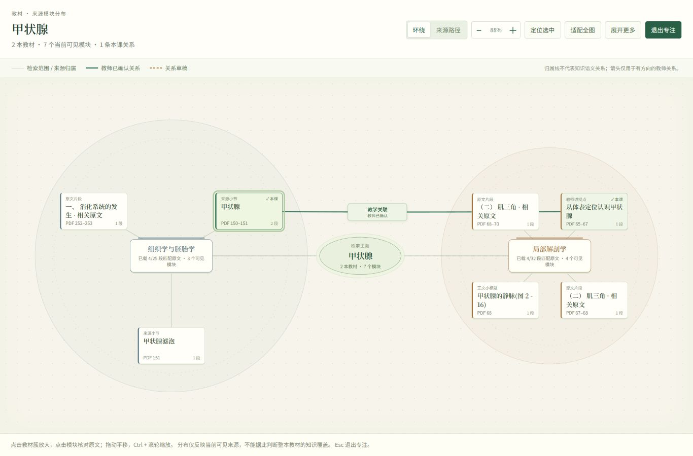

# 跨教材知识分布

入口：跨教材 → 知识分布。

## 教师使用

1. 输入课题并选择教材，检索原文。
2. “环绕”按课题、教材、来源模块组织成嵌套圆环。不同教材使用稳定颜色；全局概览保留教材名称与模块数。
3. 点击教材簇或上方教材定位条，放大查看模块标题、页码与原文数量。点击模块可回查原文、打开教材原页，或加入本课材料。
4. “来源路径”按教材列出模块及其原目录路径。“本课材料”只展示已选模块。
5. “专注分布”扩展画布；支持拖动平移、Ctrl + 滚轮缩放、方向键平移、缩放按钮和适配全图。Esc 先关闭原文侧栏，再退出专注。
6. “展开更多”继续载入当前范围内的匹配原文。窄屏按教材分组显示全部已载入模块。

## 数据含义

- 一个模块保留所属教材与来源身份；同名模块不会跨书合并。可靠教材小节与正文标题直接保留，教师命名优先；原文片段仅用真实目录上下文补充标题。
- 浅色连线表示检索范围和来源归属，不能解释成知识语义关系。深色实线表示本课教师已确认的关系，虚线表示草稿；有方向的关系才显示箭头。点击关系可核对两侧原文与连接理由。
- “已载 x/y 段匹配原文”是当前检索的分块数量，“可见模块”是当前图中的分组数量，两者分别计算。图中也会保留本课材料。
- 零召回教材仍显示。检索分布不是整本教材的完整知识覆盖；来源路径也不是完整教材目录。
- 本视图复用现有原文检索与本课关系，不新增模型调用，不按关键词命中自动推断教学关系。

## 本轮验证（2026-10-20）

- 前端 51 项模型回归通过，其中分布模型 18 项：来源身份、共同目录、重复目录 ID、模块与原文计数、零命中、输入不变性、标题来源等。
- TypeScript 与 Vite 生产构建通过；主包约 985 kB，构建仍提示包体积较大。
- 本地预览使用数据库副本，实测 7 本教材从 20 个模块增量展开至 57 个；无命中教材保留，模块和原文数量分别显示。
- 桌面验证环绕布局、教材聚焦、来源路径、专注查看、原文回查；恢复已有 2 本教材、2 段本课材料与 1 条已确认关系，点击连线可核对双侧证据。
- 390 × 844 验证所有 57 个模块进入教材分组列表，页面无横向溢出；Esc 关闭原文侧栏时保留专注状态。
- 本轮没有修改后端业务逻辑，未重跑后端测试或模型质量评测。
